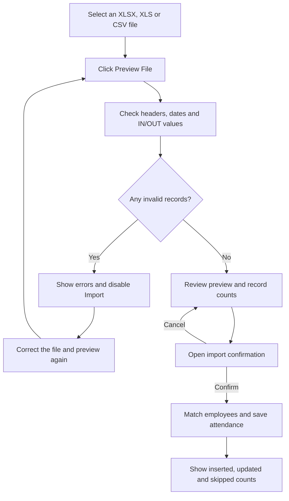
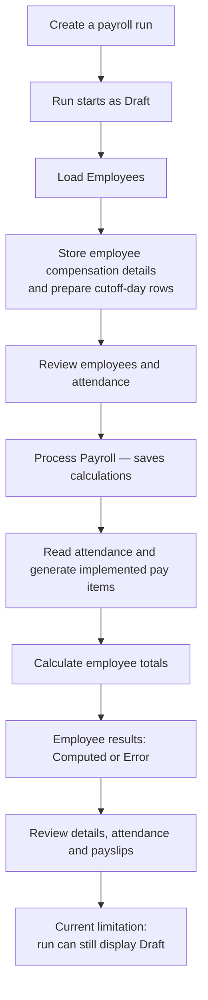
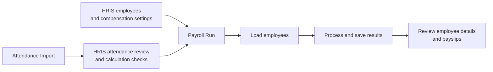

# Payroll Runs and Attendance Import Guide

Verified against the current local development implementation on **27 October 2026**.

- Project: `/home/costa/projects/monterodental-stage2-review`
- Branch: `review/md-hris-manual-refinements`
- Git HEAD: `52929377eabc8101460141b108062d2b0154b905`, with uncommitted page integrations/refinements.
- This guide describes current behaviour, including unfinished backend features. It is not full functional Payroll sign-off.

**Attendance Import brings time-in/time-out records into HRIS. Payroll Runs uses attendance and pay settings to calculate and store a payroll batch.**

Processing payroll saves calculations; salary disbursement is a separate step outside these pages.

## Attendance Import



**Selecting a file and previewing it do not save attendance records.** Preview stores temporary session data. The actual Import confirmation starts the attendance write.

The page accepts files up to **10 MB**, with a **5,000-data-row limit**. The backend checks the spreadsheet row count before removing completely blank rows. The preview displays the first **300 normalized records**, while validation and import use the full preview.

### Example file

Assume fictional employee `EMP-001` already exists and is active in HRIS:

| Device User ID | Employee No | Log Date/Time | In/Out |
| --- | --- | --- | --- |
| 101 | EMP-001 | 2026-10-05 09:00:00 | IN |
| 101 | EMP-001 | 2026-10-05 18:00:00 | OUT |

These are **two events for one employee’s attendance day**. Employee matching uses the Employee No; the required Device User ID is not the employee-matching key in the current writer.

If no attendance record exists for that day, the IN event creates it and the OUT event updates it. The result can therefore be:

| Result | Count | Meaning |
| --- | ---: | --- |
| Inserted | 1 | Created the attendance day |
| Updated | 1 | Added its time-out |
| Skipped | 0 | Both events were used |

The counts describe event outcomes, rather than unique employees.

### Common scenarios

| Scenario | Current behaviour |
| --- | --- |
| A row contains `INVALID-DATE` | Preview flags it; Import stays disabled until all invalid records are corrected. |
| Employee number does not match an active HRIS employee | The file can pass format validation, but that event is skipped during import. |
| The same IN/OUT events are imported again | Equal events are normally skipped. |
| An earlier IN or later OUT is provided | The existing attendance record can be updated. |
| A file has only an IN event | A record can be saved with no time-out. Format-valid does not mean the day is complete. |
| An error occurs partway through import | Earlier events may already be saved because transactions occur per event. |

The current matching rule retains the **earliest IN and latest OUT for each attendance day**. Skipped records are not necessarily duplicates; unmatched employees can also be skipped.

One important implementation gap remains: **this import path saves timestamps but does not recalculate worked hours, lateness, undertime or overtime.** Those values need review before relying on imported attendance for payroll. This remains a senior-review item.

## Payroll Runs

A payroll run is a batch for one cutoff and pay date.



### Main actions

| Action | What it does |
| --- | --- |
| **Status / Pay Month / Refresh** | Filters or reloads the list. Pay Month refers to the **pay date**. |
| **New Payroll Run** | Saves a batch with its cutoff and pay date. |
| **Load Employees** | Adds active employees and captures their compensation details for the run. It also prepares daily rows for the cutoff. |
| **Process Payroll** | Reads attendance, generates pay items and saves computed totals. |
| **View employee details** | Opens that employee’s Payroll Details, Attendance and Payslip tabs. |
| **Reset** | Removes the run’s loaded employees, day rows and payroll items. It currently applies to Draft runs. |

**Loading employees captures their compensation information.** Editing a compensation rate afterward does not automatically refresh the rate already stored in that run. Processing reads attendance into the prepared day rows; the compensation values come from the run’s stored employee details.

### Cutoff examples

Your code currently uses these cutoff dates:

| Selected month / period | Cutoff | Pay date |
| --- | --- | --- |
| October 2026 — First | September 30–October 14 | October 15 |
| October 2026 — Second | October 15–29 | October 30 |
| February 2026 — Second | February 15–27 | February 28 |
| February 2028 — Second | February 15–28 | February 29 |

These are the application’s existing rules. February already uses the correct month-end adjustment. The earlier reported February mismatch was retracted; no cutoff fix was required.

### Worked payroll example

The following numbers are illustrative. Suppose the run produces:

| Component | Example |
| --- | ---: |
| Daily rate | ₱800 |
| Counted regular present days | 10 |
| Basic Pay: ₱800 × 10 | ₱8,000 |
| Additional earnings | ₱1,200 |
| **Gross Pay** | **₱9,200** |
| Deductions | ₱200 |
| **Net Pay** | **₱9,000** |

The run summary’s **Earnings** value means additional earnings beyond basic pay:

```text
Gross Pay = Basic Pay + Additional Earnings
Net Pay   = Gross Pay − Deductions
```

The current processing path handles basic pay, holiday pay, overtime, allowances and lateness deductions. **Other configured Payroll Items—such as commissions, incentives and cash advances—are not all connected to processing yet.** Saving an item on its configuration page does not guarantee that it appears in a run. The current overtime implementation uses a fixed amount of 100 per hour; intended pay policy remains for senior review.

### Run status versus employee result status

There are two different status levels:

| Status belongs to | Examples | What it tells you |
| --- | --- | --- |
| Payroll run | Draft, Processed, Finalized | The batch’s workflow stage |
| Employee result | Pending, Computed, Error | Whether that employee’s calculation completed |

Currently, the backend call that moves a run to **Processed** is disabled. This explains the observed local test: four employees became **Computed**, while the run remained **Draft**. **Draft currently does not reliably mean nothing has been calculated.**

Processing can also finish with partial results—for example, **3 employees processed and 1 failed**. Individual failures are counted and the outer transaction can still commit. Review the failed employee’s error and the saved results before continuing.

## How the pages connect



Before treating this as a completed operational payroll workflow, deferred backend gaps still need senior review:

- Attendance recalculation after import.
- Processing status transitions and partial-failure handling.
- Remaining pay-item integration and overtime policy.
- Unfinished **Edit / Print Register / Finalize** features.

Individual **Print Payslip** is a separate feature from Print Register. Permissions/access and both home/dashboard pages remain outside the current review scope.

## Current local test context

The previous local test unexpectedly processed the existing `DEMO-202610` run during an intended confirmation-cancellation check. The app reported 4 employees processed, 0 failed; a read-only refresh showed gross ₱53,350.00, additional earnings ₱11,750.00, deductions ₱56.25 and net ₱53,293.75, while the run remained Draft. No reset or compensating record changes were attempted.

This is an observed demo result, not approval of the calculation policy. See the [integration and local test report](work-items/md-payroll-runs-import-integration.md) for the full exception and verification limits. Creating this guide performed no further processing or attendance import.

## Source references

These relative links point to the implementation used for this explanation:

- [Import controller: preview and import](../app/controllers/payroll/BiometricController.php)
- [Attendance model: event matching and persistence](../app/models/hris/AttendanceLogModel.php)
- [Payroll controller: creation, loading and actions](../app/controllers/payroll/PayrollRunController.php)
- [Payroll model: calculations, totals and lifecycle](../app/models/payroll/PayrollRunModel.php)
