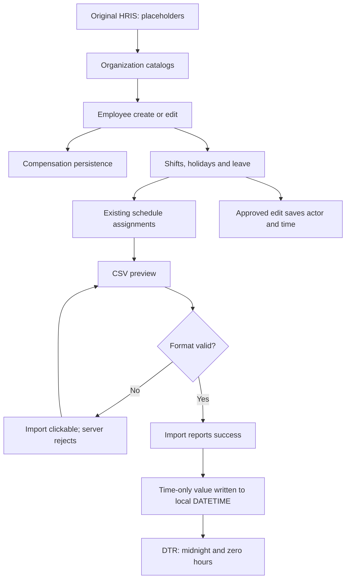
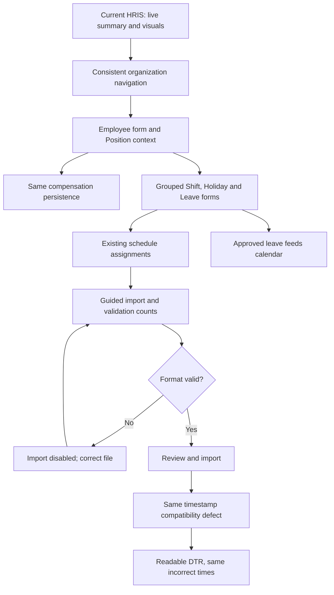
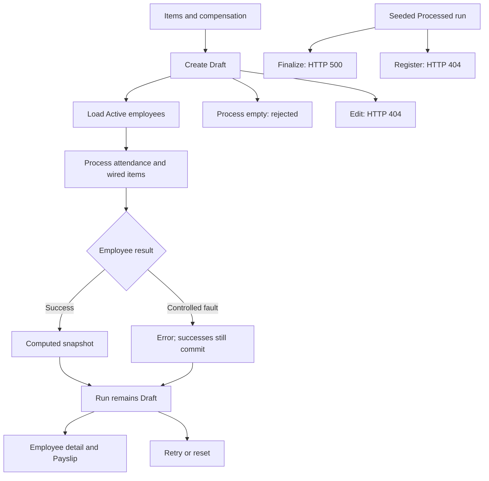
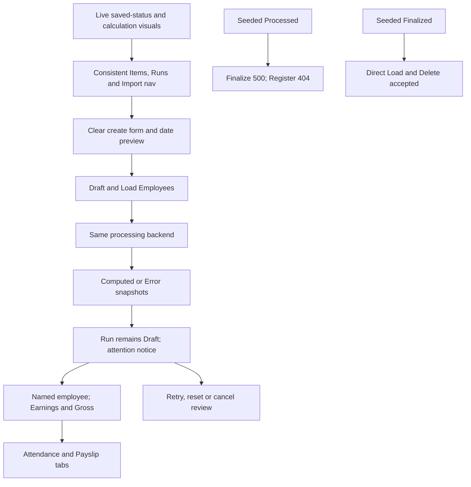

# Original versus Current: HRIS and Payroll

Audit date: **28 October 2026, Asia/Manila**. Audit/documentation only; no application fixes.

## Publication context — 28 October 2026

This is the historical comparison of the pre-publication working source. Its statements about uncommitted files and unchanged Git state describe the audit itself. The owner subsequently authorized three commits/pushes. See [publication and follow-up plan](md-hris-payroll-publication.md) for the published groups, unresolved-issue proposals and PR recommendations. The application source was not changed during publication.

## Result

**Current is substantially easier to navigate and review, but the complete payroll workflow is not working in either version.** Matched CRUD samples persisted equivalent results. Current adds useful live dashboards, clearer forms, readable financial labels, and mobile layouts. Shared problems remain in attendance import, payroll status transitions, Finalize/Edit/Register actions, cancellation traceability, and lifecycle guards.

All record-changing tests ran in two disposable copies. The existing app at **18080**, all **1,219 original database rows across 37 tables**, and all **196 pre-existing source/document files** remained unchanged. This report is uncommitted. No application fixes, staging, branch changes, merges, pushes, dependency installations or deployment were performed.

Evidence labels used below:

- **B — Browser:** actual rendered pages and UI interactions in the in-app browser.
- **I — Integration:** normal HTTP login, actual CSRF-bearing requests and committed-record checks in disposable databases.
- **Q — Query/model:** actual dashboard aggregation SQL against the current disposable database; an explicitly injected PDO exception tests one failure path.
- **S — Source:** inspected code, not a fresh workflow pass.
- **F — Fixture:** controlled setup or a previously saved illustrative scenario, not proof that a lifecycle action works.

**PASS** means the stated assertion passed; **FAIL** identifies an observed defect; **BLOCKED** means a failed route/action prevented completion; **NOT RUN** means no fresh verification. HTTP 200 or a successful harness assertion does not certify payroll/attendance correctness.

## 1. Versions and matched environments

| Item | Verified identification |
|---|---|
| Original upload | [GitHub commit c99ded60c92b33ba18f21a62a1461763fc779caa](https://github.com/BonLacorte/dental-clinic-development/commit/c99ded60c92b33ba18f21a62a1461763fc779caa), October 13 upload. Verified against GitHub, exported with `git archive`; not today's main branch. |
| Current | Complete working source including uncommitted improvements, branch `review/md-hris-manual-refinements`, HEAD `52929377eabc8101460141b108062d2b0154b905`. |
| Current fingerprint | SHA-256 `187d576d00376dae19d47262f89b2627c1de5f2e841c5eebd44170226a996910`, calculated from the sorted mapping of 196 pre-audit tracked/nonignored untracked file hashes. This new report is excluded. |
| Comparison addresses | Original `http://127.0.0.1:18081`; current `http://127.0.0.1:18082`. Windows loopback ports checked before starting. |
| Runtime | Both PHP **8.3.36**, PDO MySQL, MariaDB **10.11.19-MariaDB-ubu2204**, Manila timezone. Installed PhpSpreadsheet autoloads in both. |
| Reused images | PHP `sha256:e9a217e9a806263764e7ff024eafe8cf8764835c43d1384b0cd4bc33bf24d68d`; MariaDB `sha256:7db29378d4fdab73f8123bbc2b48905c90d1a4b00cf848b028f1e81e623257f2`. |
| Dependencies | Identical original/current `composer.lock`; installed vendor volume reused read-only. No install/upgrade. |
| Starting data | One consistent read-only snapshot, independently restored twice; every table count and row-hash aggregate matched before mutation tests: **37 tables, 1,219 rows**. |
| Business baseline | 24 employees, 22 Active, 2 branches, 436 attendance rows, 22 leave requests including 9 Pending, 7 payroll runs. Saved statuses: 3 Draft and 1 each Processing, Processed, Finalized, Cancelled. Six `DEMOEXP` runs are illustrative fixtures. |

The private exports/configuration are retained under Git-ignored `storage/comparison-audit/20261028/`, outside this report and Git. Each copy has its own database volume/internal database network, sessions, attachments and logs. Neither app is attached to the original database network. Source/dependency mounts are read-only.

### Runtime overlays, not product changes

Both apps ran directly with `php -S ... dev-router.php`, without initializer or automatic seeding. Local overlays supplied separate comparison database connections and distinct session-cookie names (`MONTERO_COMPARE_BASE` and `MONTERO_COMPARE_CURRENT`); cookies are not port-isolated. Those overlays do not count as application differences.

Both use the **existing reconstructed local demo schema**, not a verified October production schema/migration. Its attendance `time_in`/`time_out` columns are `DATETIME`. This qualification is material to the shared import failure below. Results establish behavior under the matched runtime and schema, not historical production behavior.

Windows `docker.exe` controlled the installed engine. Project/Git/Linux checks ran through Ubuntu at `/home/costa/projects/monterodental-stage2-review`. Explicit unused comparison subnets were selected after automatic Docker pools were exhausted; no global Docker configuration or existing containers were changed.

### Source and preservation boundary

PayrollRun model/controller, Biometric controller, AttendanceLog model/controller, route files, core classes and authentication backend are byte-identical between original/current. Backend source differences are the dashboard controller/model and the employee list's Position join/field. Employee write behavior is unchanged. Most changes are views, CSS, JavaScript, navigation, documentation and local tooling. See [source manifest](<C:/Users/loueg/Documents/ChatGPT/montero-dental-local/audit-evidence/base-current-20261028/source-comparison.json>).

After testing, all **196 pre-existing file hashes**, branch, HEAD and staged binary diff matched. All **37 original table row-hash maps** matched, including existing financial snapshots. Original run 1 remains gross **53,350.00**, additional earnings **11,750.00**, deductions **56.25**, net **53,293.75**. The only new nonignored project file is this report.

## 2. Page comparisons

The same 21 routes were rendered in both versions. CRUD PASS below means a dedicated unreferenced fictional record was created, edited and deleted/soft-deleted, with persisted-state checks. It does not imply every invalid combination, dependency rule or role was tested.

### Navigation and dashboards

| Page / behavior | Original | Current | Operator difference | Result / evidence |
|---|---|---|---|---|
| Module navigation | Dark sidebar, generic APP Name; this administrator sees additional Roles/Clinic/Settings links. | Teal Montero Dental shell; consistent module navigation. Payroll top nav includes Items, Runs and Attendance Import. | Easier movement between working pages. Visibility differences are recorded without changing authorization. | PASS B, matched captures. |
| HRIS Home `/hris` | “HRIS Dashboard,” “Table/chart title,” “table/chart here” placeholders. | Workforce Summary, attention/shortcuts, four live visuals and two prerequisite sections. | Managers see workforce distribution and leave workload. | PASS B/I/Q, PAGE-00. |
| Payroll Home `/payroll` | Placeholder dashboard; Schedules/Reports nav destinations return 404. | One white Summary card with four counters; attention, recent runs, shortcuts, three live visuals and three prerequisite sections. | Run status is distinguished from employee calculation state. | PASS current B/I/Q; broken legacy routes documented separately. |
| Filters | No comparable live chart controls. | GET-only date, Department/Position, run/search controls; invalid input fallback and generic unavailable-run notice. | Inspect other windows/runs without writes. | PASS I/Q, EXTRA-GET-0 through 4. |
| Empty/failure states | Placeholder, not meaningful live-data handling. | Empty tenant returns zero summaries/empty series; injected branch-query failure leaves other visuals available. | One failed chart does not remove working panels. | PASS Q, not a whole-site outage test. |
| Five prerequisites | No equivalent meaningful visuals. | Attendance Exceptions, New Hires/Departures, Gross Trend, Basic-to-Net, Gross by Branch remain unplotted with explanations. | Fixture amounts do not imply deferred calculations are validated. | PASS B/S for prerequisite presentation; calculations NOT RUN. |

Current workforce source reconciliation: **14 + 10 = 24** by branch; **22 Active**; pending ages **3, 2, 2, 2**, plus **0 invalid/future**, total **9**. Department/Position totals also reconcile. Initial payroll counts use seven runs. Later responsive screenshots can show test-run additions or deleted Finalized fixtures in disposable copies; these are not changes at 18080.

### HRIS

| Page | Original behavior | Current behavior | Practical difference | Result / evidence |
|---|---|---|---|---|
| Employees | Dense list and icon actions; existing CRUD/compensation endpoints. | Clear header/search, grouped information, labelled actions, Position context, improved forms and local table scrolling. | Clearer identification; same saved employee/compensation sample. | PASS B/I, HR-EMP-C/U/COMP/D, LIST-0. |
| Employee detail/compensation | Detail returns organization/position/employment data. | Same detail contract, refined presentation. | No employee migration or salary recalculation from the UI changes. | PASS I, EXTRA-GET-7/8 and compensation create. History overlaps NOT RUN. |
| Branches `/hris/branches` | Existing catalog/forms. | Unified header/search/table/dialogs. | Same create/edit/delete results. | PASS B/I, HR-BR-C/U/D. |
| Departments/Offices `/hris/offices` | Unit type and parent fields. | Consistent catalog forms. | Department sample uses same backend fields. | PASS B/I, HR-ORG-C/U/D; Office subtype/parent cycles NOT RUN. |
| Positions `/hris/positions` | Existing catalog CRUD. | Standard HRIS presentation/actions. | Consistent organizational lookup handling. | PASS B/I, HR-POS-C/U/D. |
| Employment Types `/hris/appointments` | Existing employment catalog. | Clearer labels and HRIS format. | Same code/name/active values saved. | PASS B/I, HR-TYPE-C/U/D. |
| Shifts `/hris/shifts` | Existing shift fields/validation. | Grouped forms following Items conventions. | Fixed-shift sample saves/updates/deletes equivalently. | PASS B/I, HR-SHIFT-C/U/D after uppercase expectation correction. Fresh employee schedule assignment UI NOT RUN. |
| Holidays `/hris/holidays` | Date/type/multiplier/work-permission catalog. | Standard table and grouped forms. | Same fictional holiday persisted; calculation policy unchanged. | PASS B/I, HR-HOL-C/U/D after normalization correction. |
| Leave `/hris/leaves` | Request/type tabs and status editing. | White tab area, green headers, clear search and grouped forms. | Pending-to-Approved edit saves approval actor/time in both. | PASS B/I, HR-LTYPE-* and HR-LEAVE-*. Other transitions remain fixture display only. |
| DTR `/hris/dtr` | Month/employee filters, daily rows/month summaries. | Same results, clearer header, captions and containment. | Readability improves; importer data problems remain visible. | Render PASS B/I; imported time accuracy FAIL in both. |

Example: create “CMP Testperson,” update its first name, add daily compensation, then delete the employee. Both copies persist the same changes. Current screens clarify the actions; they do not create a different employee lifecycle.

### All six Payroll Items pages

| Page | Original | Current | Tested persisted workflow | Result / evidence |
|---|---|---|---|---|
| Allowances | Records/Types tabs, separate dates, YES/NO recurrence, icon actions. | Employee Allowances/Types, combined effective-period context, readable recurrence/currency, labelled actions/sort feedback. | Type and employee assignment create/edit/delete; search Enter/Clear and type tab. | PASS B/I, PAY-ALLOWANCE-* and browser interactions. |
| Cash Advances | Amount, balance, deduction method, installment/status. | Same fields in shared grouped forms/table. | Create, edit installment, delete. Does not prove payroll repayment deduction. | PASS B/I, PAY-CA-C/U/D. |
| Commissions | Employee assignments and type catalog. | Standard layout, tabs and effective dates. | Dedicated type/amount assignment CRUD. | PASS B/I, PAY-COMMISSION-*. |
| Compensations | Type/frequency/rate and effective period. | Clear sections, required labels and currency. | DAILY/SEMI_MONTHLY create, rate edit, delete. | PASS B/I, PAY-COMP-C/U/D. |
| Deductions | Assignment/type and recurring/effective fields. | Standard table/search/forms. | Type and assignment CRUD. Automatic payroll inclusion not established. | PASS B/I, PAY-DEDUCTION-*. |
| Incentives | Assignment/type catalog. | Shared layout/form conventions. | Type/amount/effective-date CRUD. | PASS B/I, PAY-INCENTIVE-*. |

All four applicable type catalogs were created, edited and deleted. Compensation and Cash Advances have no invented type tabs. Missing required fields were tested on Employees, Leave, Allowances, Compensation and Cash Advances. Exhaustive date overlap/business validation was not tested.

### Import, Runs and employee payroll

| Stage | Original | Current | Operator impact | Result / evidence |
|---|---|---|---|---|
| Import landing | Basic upload/preview. | Navbar, clear steps, file expectations, counts and confirmation context. | Better guidance before importing. | PASS B/I, PAGE-20. |
| Invalid preview | Import remains enabled; server rejects it. | Both import controls disabled; correction guidance. | Prevents a predictable failed submission. | PASS I, IMPORT-INVALID-SUBMIT / IMPORT-INVALID-BUTTONS. |
| Large preview | Only 300 rows displayed. | Still 300, with improved surrounding guidance/counts. | Invalid row 301 blocks import but its detailed row is not displayed. | Safety PASS, correction visibility limited; IMPORT-301. |
| Actual valid import | Reports success, one daily row inserted/updated for paired punches. | Same saved result. | Both corrupt time values in the tested DATETIME schema. | FAIL I/B/S, F-01. |
| Repeated import | Consumed preview rejected; fresh preview accepted. | Same. | Fresh reupload reports 0 inserted / 1 updated / 1 skipped, not a strict no-op. | Consumed-preview guard PASS; broader deduplication not certified. |
| Runs list | Wide columns, compact filters, inconsistent navbar. | Labelled Pay Month/Status, combined schedule/financial groups, descriptive actions/counts. | Better review and contained scrolling; Pay Month explicitly means pay date. | PASS B/I for list/view; Edit link FAIL. |
| Creation/date preview | Month/period and preview. | Same contract with clearer sections. | February preview matches persistence; malformed native input remains accepted. | Valid dates PASS; invalid month/period FAIL. |
| Load employees | Adds eligible Active employees. | Same endpoint/snapshots. | Draft loads 22 in both; server also accepts loading Finalized. | Draft PASS; lifecycle guard FAIL. |
| Process | Computes employees but run stays Draft. | Same backend, clearer counts/error context. | Computed is not approval/finalization. | Complete lifecycle FAIL; monetary outputs match. |
| Partial error/retry | Successful employees commit alongside employee errors. | Same. | Inspect every result despite HTTP success. | Actual 21 Computed / 1 Error under controlled fault I/F. |
| Reset/cancel/delete | Existing endpoints. | Better presentation, but list/detail availability inconsistent. | Reset clears snapshots; Cancel loses audit fields; Finalized delete accepted. | Mixed; F-03/F-06. |
| Finalize/register | Missing method/route. | Same failures despite offered actions for saved statuses. | Cannot complete these paths. | BLOCKED I/S: 500 Finalize; 404 Register. |
| Employee payroll | “Employee #1”; “Gross / Earnings” shows extras, not gross. | “Demo, Ana”; Earnings separated from Gross Pay. | Correctly distinguishes identity and amounts. | PASS B; same copied basic 14,400 / extras 4,950 / gross/net 19,350. |
| Attendance/Payslip tabs | Tabs work; “Company Name” fallback. | Named employee, captions/scroll containers; fallback remains. | Better identification, unresolved branding. | Tabs PASS B; branding shared; physical print NOT RUN. |

## 3. Workflow walkthroughs and diagrams

### HRIS: original

Open HRIS placeholders, maintain organization catalogs, create/edit employee and save compensation. Configure shifts/holidays and leave; Pending-to-Approved edit saves actor/time. Existing schedules are inputs to attendance/payroll. Import a CSV and inspect DTR by employee/month. Invalid preview is rejected by the server despite an enabled Import button. A valid paired-punch file produces midnight/zero-hour DTR values under this local schema.

Schedule assignment is an existing data dependency in the diagram, not a claim of a freshly tested scheduling UI.

### HRIS: current

Start with live Workforce Summary/Insights. Navigate consistent organization/employee forms; the list has Position context. Leave, Holidays and Shifts adopt grouped Items forms. Invalid import has clearer counts and disabled controls; correct and preview again. The importer remains unchanged, so accepted punches still produce the same bad DTR times. Better presentation does not fix stored data.

### Payroll: original

Maintain compensation and Items; choose a month/period, inspect preview and create Draft. Load employees; processing before loading is rejected. Actual processing computes employees but leaves the run Draft. An unsupported salary fixture produces partial committed results. Employee detail/payslip tabs display snapshots, but there is no working complete path through Finalize/Register: those targets fail. Draft Edit fails too.

### Payroll: current

Review saved-status counts, calculation progress, dates and attention notices first. Navigate to Items/Runs/Import using the navbar. Clearer forms still call the same create/load/process endpoints. Named employee details separate extra Earnings from Gross. The computed-Draft warning helps reveal the lifecycle defect; it does not resolve it. The detail page hides its danger section for Finalized, but list source still renders Delete for every status and the server accepts Finalized deletion/loading.

### Concrete matched financial example

A fresh January 2027 first-period Draft loaded **22 Active employees** in both copies. Controlled identical attendance setup supplied employee 1 three days: 09:00–18:00 ordinary; 09:15–18:00 with 15 late minutes; 09:00–19:00 with 60 overtime minutes. These rows were direct fictional fixture setup, not a successful importer result.

Actual HTTP processing returned 22 processed / 0 errors. Employee 1 saved:

| Amount | Original | Current |
|---|---:|---:|
| Basic | 5,400.00 | 5,400.00 |
| Additional earnings | 550.00 | 550.00 |
| Gross | 5,950.00 | 5,950.00 |
| Deductions | 112.50 | 112.50 |
| Net | 5,837.50 | 5,837.50 |

Generated codes were BASIC_PAY, LATE, MEAL and OVERTIME. All 22 saved employee monetary observations matched. Reprocessing retained 25 items and the same summed amount in this sample; that is not a general idempotency guarantee. The existing model uses lateness multiplier 2 and overtime 100/hour. This audit neither changed nor endorsed those policies. Equal numbers do not certify business-rule correctness.

## 4. Differences in operation

| Dimension | Current change | Important limit |
|---|---|---|
| Navigation | Consistent Runs/Import top nav; absent legacy Schedules/Reports links. | Removing a link does not implement its missing backend route. |
| Steps | Grouped forms, contextual Add action, active type/record tabs. | Same CRUD contracts/persistence. |
| Unsaved work | Allowance Cancel shows “Discard your unsaved changes?” and focuses Stay Editing; Discard closes. Original Close immediately discards entered amount. | Representative form test, not every dismissal/browser-close path. |
| Validation | Invalid import controls disabled, required labels, visible search scope/no-match guidance. | Server still accepts invalid payroll month/period. |
| Feedback | Descriptive loading/count/error messages and local scroll guidance. | Success can coexist with corrupt timestamps, partial errors or Draft after computation. |
| Live data | Tenant-scoped aggregation, filters, exact-value charts. | Five deferred charts remain unplotted. Fixtures do not validate them. |
| Financial display | Names employee and separates Gross from additional Earnings. | No sampled stored calculation change. |
| Persistence | **74/74 matched HR/PAY/RUN observation cases equal** in the initial integration round. | Shared failures also match; no general correctness certification. |
| Access | Auth backend/route policy source unchanged; existing layout visibility differences recorded. | No access configuration changes or fresh full role matrix test. |

## 5. Findings register

P1 = high-impact data/lifecycle issue needing senior review before operational payroll use. P2 = broken feature/important workflow or traceability limit. P3 = presentation/help issue. Only fictional local copies were exercised.

| ID | Classification | Reproduction / observed result | Scope and evidence |
|---|---|---|---|
| F-01 | Shared local runtime/data defect, **P1 — FAIL** | Import IN `2026-12-02 08:00:00`, OUT `2026-12-02 17:00:00` for DEMOEXP-001. Success response, but stored `2008-00-00 00:00:00` / `2017-00-00 00:00:00`; DTR shows midnight, 0.00 hours, Present. Model extracts only H:i:s for local DATETIME columns. | Both; Import→DTR→payroll. I/B/S: IMPORT-COMMIT, IMPORT-SCHEMA, browser dtr-after-import. Verify against authoritative schema before designing a fix. |
| F-02 | Shared lifecycle defect, **P1 — FAIL** | Create/load/process Draft. 22 Computed employees, saved run still Draft. Run-level processed transition commented out. | Both; I/S: RUN-PROCESS, model near line 1575. |
| F-03 | Shared lifecycle guards, **P1 — FAIL** | On a saved Finalized scenario copy, POST Load adds 14 missing employees; status stays Finalized. POST Delete removes it. Process/Reset correctly reject Finalized with 422. Delete status guard is commented; load has no equivalent guard. | Both; I/F/S: RUN-GUARD-*. Seeded Finalized is a test precondition, not a Finalize pass. Current list also renders Delete regardless of status. |
| F-04 | Missing features, **P2 — FAIL/BLOCKED** | Draft Edit 404; Processed run3 Print Register 404; POST Finalize run3 returns 500 and remains Processed. Registered method absent. | Both; I/S: visible-actions files. |
| F-05 | Validation, **P2 — FAIL** | Create `payroll_month=2026-00`, `period_no=3`: accepted; saves period 3, cutoff 15–30 Dec2025, pay 31 Dec2025. | Both; I: RUN-CREATE-2026-00-3. |
| F-06 | Traceability, **P2 — FAIL** | Cancel Draft with nonempty cancellation_reason. Status Cancelled, but reason/actor/cancelled_at NULL. | Both; I/S: RUN-CANCEL. |
| F-07 | Partial-processing policy, **P1 review — OBSERVED** | Inject one unsupported salary snapshot. Actual processing commits 21 Computed/1 Error, HTTP 200 success, still Draft. Error rollback is commented out. | Both; I/F/S: RUN-PARTIAL. Senior must define partial-result/lifecycle policy; not a new UI regression. |
| F-08 | Incomplete calculation coverage, **P1 review — S** | Pipeline calls basic/holiday/overtime/allowance/late. Commission, incentive, configured deduction and advance repayment are not demonstrated as wired steps. CRUD success does not establish application to payroll. | Both; S supported by sampled generated codes. Dedicated test of every item rule NOT RUN. |
| F-09 | Payslip branding, **P3** | Payslip tab says “Company Name” in both; original “Employee #1” is fixed to Demo, Ana in current. | B, screenshots/tab text. |
| F-10 | Large-preview correction, **P2** | 301 rows with invalid datetime at 301: only 300 detailed rows shown, invalid detail outside table; import correctly rejects 422 and writes 0 rows for the date. | Both; I: IMPORT-301. Safety PASS, correction visibility limited. |
| F-11 | Date wording, **P3** | Second-period option says “Pay on the 30th” even for correct February 28/29 preview. | Both; B/I. Wording issue, **not February cutoff mismatch**. |
| I-01 | Improvement — PASS | Live scoped summaries/visuals replace placeholders; nine model/query checks pass. | Current B/I/Q. |
| I-02 | Improvement — PASS | Consistent headers/tables/grouped forms and contextual Add action. | Current B; representative tab/form tests. |
| I-03 | Improvement — PASS | Disabled invalid Import, Allowance unsaved-change prompt, labelled accessible controls. | Current B/I; not full accessibility certification. |
| I-04 | Improvement — PASS | Named employee, correct Gross versus additional Earnings presentation. | Current B/I; saved money unchanged. |
| I-05 | Improvement — PASS | No root overflow on 21 sampled current routes at 375px, versus 21 original overflow. | B, matched dimensions. |

**No new persisted CRUD/calculation regression was detected in these matched cases.** This is a bounded result. F-01 and F-03 were newly exposed by testing but occur in original too; they were not introduced by current presentation work.

Source references: [timestamp extraction](<//wsl$/Ubuntu/home/costa/projects/monterodental-stage2-review/app/models/hris/AttendanceLogModel.php:610>), [processing status/commit](<//wsl$/Ubuntu/home/costa/projects/monterodental-stage2-review/app/models/payroll/PayrollRunModel.php:1575>), [delete guard](<//wsl$/Ubuntu/home/costa/projects/monterodental-stage2-review/app/models/payroll/PayrollRunModel.php:1796>), [list actions](<//wsl$/Ubuntu/home/costa/projects/monterodental-stage2-review/app/views/module_payroll/payroll_run_index.php:459>), [Finalize route](<//wsl$/Ubuntu/home/costa/projects/monterodental-stage2-review/routes/payroll-routes.php:110>), [local schema qualification](<//wsl$/Ubuntu/home/costa/projects/monterodental-stage2-review/scripts/demo-schema.php:1>).

## 6. Fresh verification and limits

| Check | Original | Current | Boundary |
|---|---|---|---|
| Login,21 GET routes | PASS | PASS | Fictional administrator only. |
| 21 desktop browser pages | PASS render | PASS render | 1440×1000, no root overflow; not a functional readiness pass. |
| 21 mobile pages | FAIL layout | PASS sampled layout | 375×812: original 21/21 root overflow, current 0/21. |
| Tablet/narrow mobile | Mixed/FAIL | PASS sampled layout | 768×1024 and 320×812: Home pages, Employees, Allowances, run detail, Import. Original tablet employee/items/run detail overflow; all six original 320px samples overflow; no current overflow. |
| Keyboard search | PASS | PASS | Allowance Enter/Clear/no-match sample. |
| Tabs/cancel | PASS basic | PASS improved | Allowance type, employee Attendance/Payslip, dirty Cancel. Not every focus path. |
| HRIS catalogs/employee/leave, six Items CRUD | PASS sampled contracts | PASS sampled contracts | Dedicated records and saved state checked. |
| Required-field rejection | PASS | PASS | Five endpoints; not exhaustive business/security validation. |
| 12 list endpoint requests | PASS response contracts | PASS response contracts | Search/page2/created-at sort on Employees, Leave, Allowances, Runs. Full per-column sort correctness NOT RUN. |
| Actual CSV import | Preview PASS; storage FAIL | Same | Real multipart and committed clone records. |
| Invalid/consumed/row 301 import guards | PASS | PASS with better controls | Fresh reupload still updates; broad deduplication not certified. |
| Create/load/process/reprocess | Mixed; lifecycle FAIL | Same | Actual amounts compared, business policy not certified. |
| Controlled partial error | Partial commit observed | Same | Explicit unsupported salary fixture. |
| Draft reset/cancel/delete | Reset/delete PASS; cancel audit FAIL | Same | Reset empties snapshots; cancellation metadata lost. |
| Finalized guards | Load/delete FAIL; process/reset rejection PASS | Same | Fixture status only. |
| February saved dates | PASS | PASS | 2026 cutoff 15–27/pay 28; leap 2028 cutoff 15–28/pay 29. Browser preview sampled 2026. |
| Invalid month/period | FAIL | FAIL | 2026-00/3 accepted. |
| Finalize/Edit/Register | BLOCKED | BLOCKED | Actual500/404/404. |
| Dashboard invalid filters | No comparable feature | PASS | HTTP fallback/generic notices. |
| Dashboard reconciliation/empty/foreign/fault | No comparable feature | PASS, 9 checks | Actual SELECT SQL, one injected PDO exception, no writes. |
| PHP lint | PASS, 119 files | PASS, 122 files | App/core/routes/public snapshots. |
| Preservation | PASS | PASS | 196 pre-existing files, staged diff, branch/HEAD ; 37 original tables / 1,219 rows. |

Initial integration output has **119 assertions per version: 114 PASS, 2 FAIL, 3 OBSERVED**. The two raw FAILs are harness expectations: Shift/Holiday names are intentionally uppercased by existing controllers. Responses succeeded and persisted normalized values; these are evaluated as successful updates. The initial disabled-import regex used obsolete IDs; actual-control parsing in follow-up supersedes it. The initial DTR ISO-date substring check did not match formatted dates; actual DTR rows were then inspected in browser. See [evaluation notes](<C:/Users/loueg/Documents/ChatGPT/montero-dental-local/audit-evidence/base-current-20261028/evaluated-results.json>).

Additional matched follow-ups cover import controls/reupload/schema/row 301, filters/detail endpoints, Finalized guards and visible broken action targets. Nine current model/query checks pass. Counts are execution evidence, **not a business-readiness percentage**.

### NOT RUN / verification limits

- Physical printer/PDF pagination, browser print preview, every print-media layout. Screen Payslip tabs and print CSS were inspected; native print dialog was not opened.
- Exhaustive keyboard/screen-reader/zoom/contrast testing, every modal dismissal, or all browsers. Representative labels/focus/search and layouts checked.
- Full role/permission/cross-tenant CRUD security audit. Dashboard foreign-run lookup tested at model scope; access policies unchanged.
- XLSX-specific formats, every biometric export, size/MIME attacks, concurrency/races and crash recovery. CSV success/error/retry were real requests.
- New employee schedule assignment UI, hardware scan events, every shift/fallback variant and every leave transition. Existing assignments/scenario statuses are fixtures.
- Every effective-date overlap, compensation-history collision, referenced catalog deletion, overnight attendance, government deduction, salary frequency or legal payroll policy.
- Successful end-to-end Finalize/Register: actual actions failed; seeded Processed/Finalized data is not substituted for a pass.
- Historical October database/runtime. Both sources intentionally use the same current fictional schema/runtime.

## 7. Screenshots and local evidence

Screenshots show fictional demo records and exclude credentials/cookies/CSRF values. Evidence links are local to this workstation. Private exports, configuration and sessions are not linked.

| Capture | Original | Current |
|---|---|---|
| HRIS desktop | [Image](<C:/Users/loueg/.codex/visualizations/2026/10/27/01a17bde-13e2-7bc3-99b4-c6b8d2508889/base-current-20261028/base-hris-desktop.png>) | [Image](<C:/Users/loueg/.codex/visualizations/2026/10/27/01a17bde-13e2-7bc3-99b4-c6b8d2508889/base-current-20261028/current-hris-desktop.png>) |
| Payroll desktop | [Image](<C:/Users/loueg/.codex/visualizations/2026/10/27/01a17bde-13e2-7bc3-99b4-c6b8d2508889/base-current-20261028/base-payroll-desktop.png>) | [Image](<C:/Users/loueg/.codex/visualizations/2026/10/27/01a17bde-13e2-7bc3-99b4-c6b8d2508889/base-current-20261028/current-payroll-desktop.png>) |
| Payroll 320px | [Image](<C:/Users/loueg/.codex/visualizations/2026/10/27/01a17bde-13e2-7bc3-99b4-c6b8d2508889/base-current-20261028/base-payroll-320.png>) | [Image](<C:/Users/loueg/.codex/visualizations/2026/10/27/01a17bde-13e2-7bc3-99b4-c6b8d2508889/base-current-20261028/current-payroll-320.png>) |
| Payslip screen | [Image](<C:/Users/loueg/.codex/visualizations/2026/10/27/01a17bde-13e2-7bc3-99b4-c6b8d2508889/base-current-20261028/base-payslip-screen.png>) | [Image](<C:/Users/loueg/.codex/visualizations/2026/10/27/01a17bde-13e2-7bc3-99b4-c6b8d2508889/base-current-20261028/current-payslip-screen.png>) |
| DTR after import | [Image](<C:/Users/loueg/.codex/visualizations/2026/10/27/01a17bde-13e2-7bc3-99b4-c6b8d2508889/base-current-20261028/base-dtr-import-result.png>) | [Image](<C:/Users/loueg/.codex/visualizations/2026/10/27/01a17bde-13e2-7bc3-99b4-c6b8d2508889/base-current-20261028/current-dtr-import-result.png>) |

Machine-readable records:

- [Matched desktop](<C:/Users/loueg/Documents/ChatGPT/montero-dental-local/audit-evidence/base-current-20261028/browser-pages.json>), [375px](<C:/Users/loueg/Documents/ChatGPT/montero-dental-local/audit-evidence/base-current-20261028/browser-responsive.json>), [tablet/320px](<C:/Users/loueg/Documents/ChatGPT/montero-dental-local/audit-evidence/base-current-20261028/browser-responsive-extra.json>), [interactions](<C:/Users/loueg/Documents/ChatGPT/montero-dental-local/audit-evidence/base-current-20261028/browser-interactions.json>).
- [Original integration](<C:/Users/loueg/Documents/ChatGPT/montero-dental-local/audit-evidence/base-current-20261028/integration-base.json>), [current integration](<C:/Users/loueg/Documents/ChatGPT/montero-dental-local/audit-evidence/base-current-20261028/integration-current.json>), [74 matched persisted observations](<C:/Users/loueg/Documents/ChatGPT/montero-dental-local/audit-evidence/base-current-20261028/persisted-comparison.json>).
- [Original follow-up](<C:/Users/loueg/Documents/ChatGPT/montero-dental-local/audit-evidence/base-current-20261028/followup-base.json>), [current follow-up](<C:/Users/loueg/Documents/ChatGPT/montero-dental-local/audit-evidence/base-current-20261028/followup-current.json>), [original visible actions](<C:/Users/loueg/Documents/ChatGPT/montero-dental-local/audit-evidence/base-current-20261028/visible-actions-base.json>), [current visible actions](<C:/Users/loueg/Documents/ChatGPT/montero-dental-local/audit-evidence/base-current-20261028/visible-actions-current.json>).
- [Dashboard SQL/model](<C:/Users/loueg/Documents/ChatGPT/montero-dental-local/audit-evidence/base-current-20261028/dashboard-queries.json>), [setup](<C:/Users/loueg/Documents/ChatGPT/montero-dental-local/audit-evidence/base-current-20261028/setup-summary.json>), [runtime/lint](<C:/Users/loueg/Documents/ChatGPT/montero-dental-local/audit-evidence/base-current-20261028/runtime-lint.json>), [preservation](<C:/Users/loueg/Documents/ChatGPT/montero-dental-local/audit-evidence/base-current-20261028/preservation.json>).

Initial background-tab captures had a different viewport and were explicitly superseded. Cited desktop/mobile files were recaptured in one active tab with verified actual widths. Negative 15px extra-layout measurements are scrollbar space, not overflow. Superseded captures are not used for conclusions.

## 8. Completion and reproduction

After testing, only the **four new comparison containers** (two apps, two databases) were stopped. Their snapshots, disposable volumes, runtime overlays, guarded harnesses and sanitized evidence are retained. Original app/database at 18080 remain running. See [completion checks](<C:/Users/loueg/Documents/ChatGPT/montero-dental-local/audit-evidence/base-current-20261028/completion.json>).

To reproduce, restore the retained initial private snapshot into **only the comparison databases**, use the retained original/current exports and same images/read-only dependencies, then run the guarded harnesses. Restore before repeating a complete suite: it creates/deletes records and uses fixed test periods. Never direct mutation tests at 18080. Harnesses require a matching `audit_clone` configuration marker.

No application code or business policy was changed. Findings are recorded for review; the report remains uncommitted.
